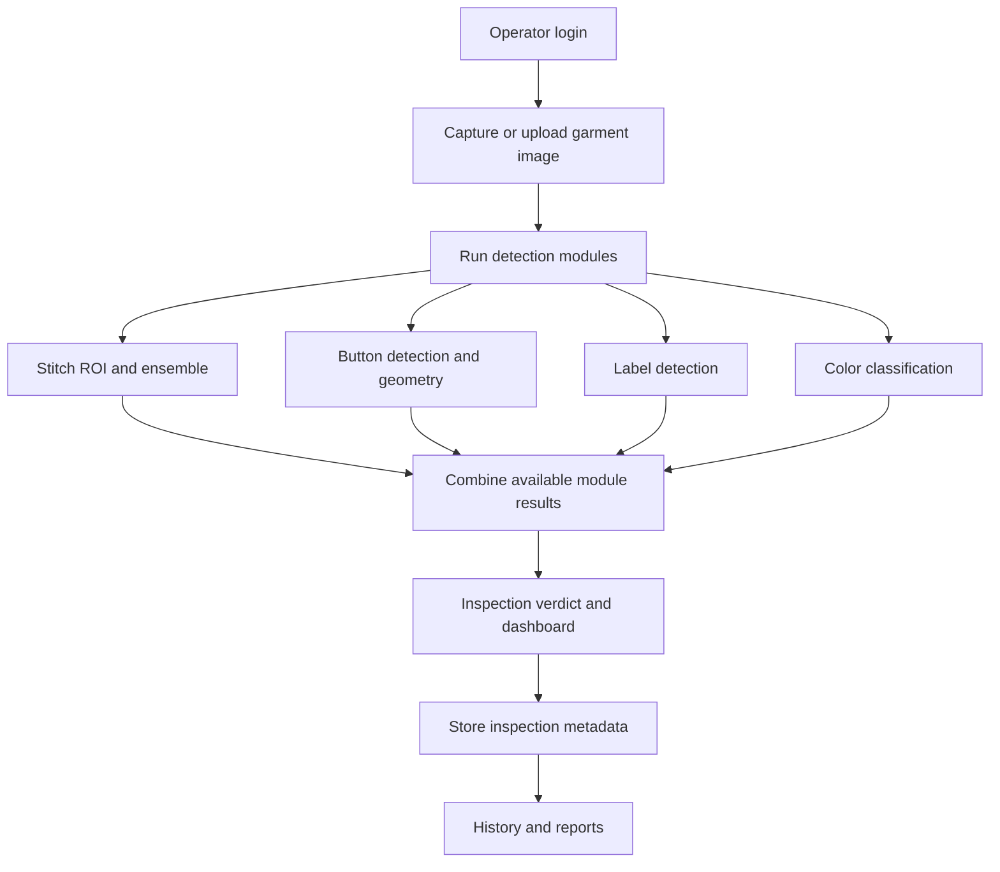

<div align="center">

# 🧵 Garment Defect Detection System

### A Deep Learning-Based Computer Vision System for Garment Quality Inspection

**Automated inspection of broken stitches, button defects, garment labels, and color imbalance through a Flask web application.**


**Team Aurors** · Faculty of Applied Sciences · Rajarata University of Sri Lanka  
**2021/2022 Batch** · Supervisor: **Mr. E.A.C.I. Senaratne**

</div>

---

## 📑 Contents

- [Overview](#-overview)
- [Objectives](#-objectives)
- [Features](#-features)
- [Detection Modules](#-detection-modules)
- [System Workflow](#-system-workflow)
- [Technology Stack](#-technology-stack)
- [Getting Started](#-getting-started)
- [Database Setup](#-database-setup)
- [Model Files](#-model-files)
- [Evaluation Results](#-evaluation-results)
- [Data Privacy](#-data-privacy)
- [Team](#-team)
- [Project Status and Limitations](#-project-status-and-limitations)

## 🎯 Overview

Manual garment quality inspection is labor-intensive and can be inconsistent, particularly when several types of defects must be checked. This project integrates computer vision and deep learning models into a single inspection interface to assist operators with consistent defect screening and reporting.

The application supports four inspection categories: **broken stitches**, **missing or misaligned buttons**, **missing garment labels**, and **color imbalance**. It combines model predictions with rule-based checks and presents an inspection-level **PASS / FAIL** decision. The system is intended as a decision-support tool; its results should be validated before use in production quality control.

## 🚀 Objectives

1. Identify broken stitches in garment images.
2. Detect buttons and evaluate missing-button gaps and alignment.
3. Detect garment label presence.
4. Classify color imbalance.
5. Provide an operator-friendly dashboard, inspection history, and reports.

## ✨ Features

- Operator registration, PIN-based login, and account recovery.
- Image-based garment inspection through a Flask web interface.
- Four integrated defect-detection modules.
- Per-module outcomes and an overall inspection verdict.
- Dashboard statistics, inspection history, and report generation.
- MariaDB-backed storage of inspection and defect metadata.
- Temporary image processing rather than permanent inspection-image storage.

## 🔍 Detection Modules

| Module | Implemented approach | Key components |
|---|---|---|
| 🧵 Broken stitches | Stitch-region localization followed by ensemble classification | YOLO ROI detector; MobileNetV2, EfficientNetB0, Vision Transformer |
| 🔘 Button defects | Button object detection and geometric spacing/alignment rules | YOLO and spatial analysis |
| 🏷️ Garment labels | Detection of the label region/presence | YOLO label detector |
| 🎨 Color imbalance | Deep-learning image classification | ResNet50 and model-specific preprocessing |

### Broken-stitch ensemble

The stitch inspection pipeline first identifies a stitch region of interest (ROI), then combines predictions from three classifiers:

| Classifier | Ensemble weight |
|---|---:|
| MobileNetV2 | 40% |
| EfficientNetB0 | 25% |
| Vision Transformer (ViT) | 35% |

The configured ensemble decision threshold is **0.50**. The ensemble weights and threshold are implementation settings, not independently measured performance values.

### Button inspection

Detected button positions are checked for irregular gaps and misalignment. Where too few buttons are detected for reliable geometric evaluation, the button check may be reported as **NOT_TESTED**, rather than presenting an unsupported PASS or FAIL.

### Label inspection

The integrated label module uses YOLO object detection. **OCR-based label text verification should not be assumed to be part of the current end-to-end workflow** unless separately enabled and tested.

## 🏗️ System Workflow



The system uses a Flask backend, Jinja2 web templates, detection utilities, and a relational database. Each model handles its required image preprocessing within its own pipeline.

## 🛠️ Technology Stack

| Layer | Technologies |
|---|---|
| Language | Python |
| Deep learning | TensorFlow / Keras, Ultralytics YOLO, MobileNetV2, EfficientNetB0, ViT, ResNet50 |
| Image processing | OpenCV, NumPy |
| Web application | Flask, Jinja2, Flask-Login, Flask-WTF |
| Database | MariaDB via XAMPP, SQLAlchemy, PyMySQL |
| Reporting | Python-based report generation |
| Development and training | VS Code, Google Colab, Git, GitHub |

## ⚡ Getting Started

### Prerequisites

- Windows with Python and pip installed.
- Git (to clone the repository).
- XAMPP with its **MySQL** service running (the supplied development environment uses MariaDB).
- The required trained model files, which may be distributed separately from the Git repository.

### 1. Clone the repository

```powershell
git clone https://github.com/Ishini01/garment_defect_system.git
cd garment_defect_system
```

### 2. Create and activate a virtual environment

```powershell
python -m venv venv
.\venv\Scripts\Activate.ps1
```

If PowerShell blocks activation, use Command Prompt and run `venv\Scripts\activate.bat` instead.

### 3. Install dependencies

```powershell
python -m pip install --upgrade pip
python -m pip install -r requirements.txt
```

> **Note:** Model compatibility can depend on the TensorFlow/Keras, Ultralytics, and Python versions used during training. Use the project's tested environment where possible.

### 4. Configure the database

Follow [Database Setup](#-database-setup) below and ensure the connection in `backend/app.py` matches your local MariaDB credentials.

### 5. Place the trained model files

See [Model Files](#-model-files). The Flask application must be able to load the configured weights before all inspection modules can run.

### 6. Start the application

From the project root:

```powershell
python backend/app.py
```

Open the address printed by Flask, typically **http://127.0.0.1:5000/**, then register or log in as an operator.

## 🗄️ Database Setup

1. Open **XAMPP Control Panel** and start **MySQL**. Start **Apache** as well if using phpMyAdmin.
2. Open **http://localhost/phpmyadmin/**.
3. Create a database named `garment_defect_db`.
4. Confirm that the SQLAlchemy connection configuration in `backend/app.py` matches the database server, username, and password.
5. Start Flask and check the terminal for database connection errors.

The local development configuration previously used:

```python
mysql+pymysql://root:@localhost/garment_defect_db
```

This example assumes a local `root` account with an empty password. **Do not use these credentials for a public or production deployment.** Store production credentials securely and use a dedicated database account.

The application records operator, inspection-session, and defect information. Database schema details are maintained in the project implementation and design documentation.

## 🧠 Model Files

Trained weights may be too large for ordinary Git commits and are **not guaranteed to be included in a fresh clone**. The application expects model paths configured in its backend detection utilities.

Known model artifacts include:

| Module | Model artifact / role |
|---|---|
| Buttons | `models/best.pt` |
| Labels | `models/label_best.pt` |
| Stitch ROI | `models/stitch_roi_best.pt` |
| Stitch classification | MobileNetV2, EfficientNetB0, ViT trained `.keras` models |
| Color imbalance | `models/color_imbalance_model.h5` |

Check the model-loading paths in `backend/utils/` before running the system on a new machine. Do not commit trained weights, inspection images, credentials, or private datasets without confirming their size, ownership, and sharing permissions.

## 📈 Evaluation Results

The following are **previously reported module-level evaluation results**. They should **not** be interpreted as end-to-end accuracy for the complete system.

| Component | Reported metric | Result |
|---|---|---:|
| Broken-stitch ensemble | Classification accuracy on stitch-focused test images | **98.08%** |
| Button hybrid detector | Decision accuracy on 209 evaluation images | **90.43%** |
| Label detector | YOLO mAP@0.50 | **88.05%** |
| Color imbalance classifier | Classification accuracy | **91.67%** |

### Overall System Accuracy

**Overall integrated system accuracy: Not yet measured (N/A).** An end-to-end evaluation requires a labeled set of complete garment inspections, comparing the system’s final **PASS / FAIL** decision against the known ground truth for each garment.

For reference, the **unweighted arithmetic mean of the four reported module scores is 92.06%**:

```text
(98.08 + 90.43 + 88.05 + 91.67) / 4 = 92.06%
```

> **Important:** 92.06% is a descriptive average of *different evaluation metrics*, **not validated overall system accuracy**. In particular, the label score is mAP@0.50, not classification accuracy. These component results were obtained from different evaluation sets and cannot establish the accuracy of the combined decision.

To report verified overall accuracy, evaluate the complete pipeline on an independent, labeled garment test set:

```text
Overall system accuracy (%) =
  (Number of correct final PASS/FAIL decisions / Total labeled inspections) × 100
```

End-to-end evaluation should additionally examine mixed-defect images, module failures, false positives/negatives, inspection latency, and real production conditions.

## 🔒 Data Privacy

The intended application workflow processes garment images temporarily and stores inspection **metadata** rather than permanently saving uploaded inspection images. Inspection history and reporting use stored session/defect records. Deployments should separately verify temporary-file cleanup, access controls, database backups, and report retention before handling sensitive factory data.

## 👥 Team

**Team Aurors — Rajarata University of Sri Lanka**

| Team member | Registration number | Index number |
|---|---|---|
| M.A.I.A. Ranathunga | ICT/2022/082 | 5686 |
| C. Ashini Kumarawadu | ICT/2022/033 | 5639 |
| M.F.F. Fazeena | ICT/2022/024 | 5631 |
| G.C.P.A. Hemasiri | ICT/2022/067 | 5671 |
| I.O. Subasinghe | ICT/2022/002 | 5610 |

**Supervisor:** Mr. E.A.C.I. Senaratne  
**Faculty:** Faculty of Applied Sciences, Rajarata University of Sri Lanka

## 📌 Project Status and Limitations

The Flask application and four detection modules have been integrated and tested by the project team. Further independent acceptance testing and validation under production-like conditions remain important.

- Performance depends on garment type, image quality, lighting, camera positioning, and dataset coverage.
- Button geometry may be inconclusive when insufficient buttons are visible.
- Label presence detection does not, by itself, verify printed label text or correctness.
- Module-level metrics do not establish the accuracy of the combined PASS/FAIL decision.
- Model weights and local database configuration are required for a complete installation.

---

<div align="center">

**Developed by Team Aurors · Rajarata University of Sri Lanka**

*Academic research and software development project for garment quality inspection.*

</div>
